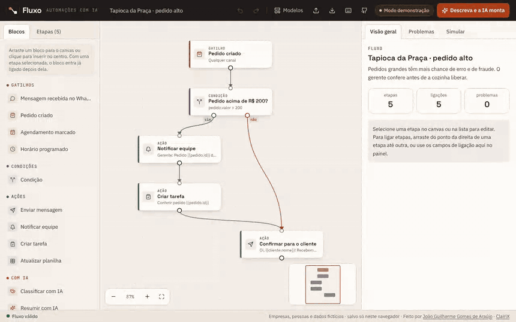
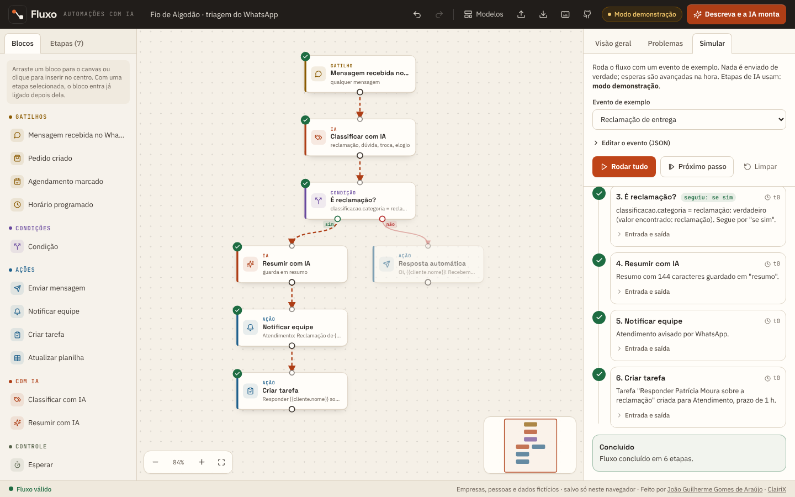
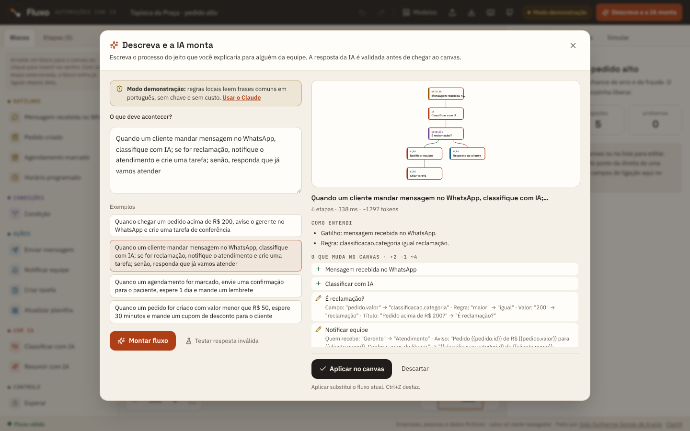
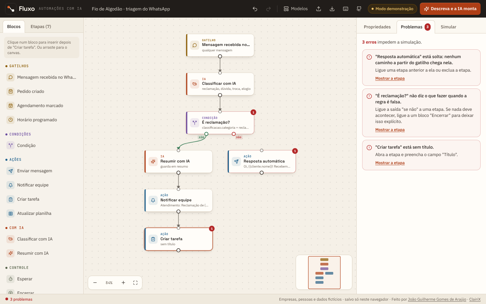
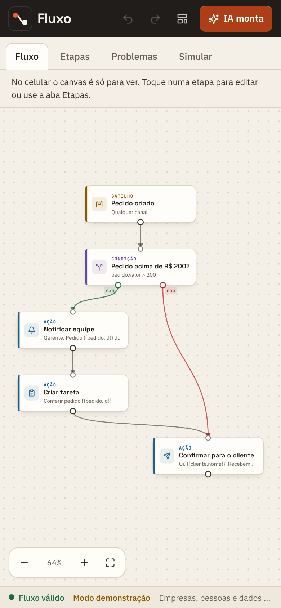

<div align="center">

# Fluxo

**Construtor visual de automações para pequenos negócios: você descreve o processo em português, a IA monta o fluxo e o sistema garante que ele roda.**

Gatilhos, condições e ações num canvas, com validação ao vivo, simulador passo a passo e etapas de IA que classificam e resumem mensagens. A resposta do modelo passa por um esquema em código antes de tocar no canvas.

[](https://github.com/PRESSXF/fluxo-ai-automations/actions/workflows/ci.yml)


[**Abrir a demo**](https://fluxo-ai-automations.vercel.app) · [Como funciona](#como-funciona) · [Avaliações](#testes-e-avalia%C3%A7%C3%B5es) · [Rodar localmente](#rodar-localmente)



</div>

## O problema

Dono de restaurante, clínica ou loja repete as mesmas tarefas todo dia: avisar o gerente quando entra um pedido grande, confirmar consulta, lembrar o paciente na véspera, separar reclamação de dúvida no WhatsApp. Ferramentas como n8n e Make resolvem, mas assustam quem nunca montou uma automação, e um erro de configuração só aparece quando o cliente reclama.

Pedir para um modelo de linguagem "fazer a automação" também não basta. Ele entende bem o pedido, mas pode inventar um tipo de etapa que não existe, deixar um caminho sem saída ou criar um ciclo que dispara mensagens sem parar.

## A solução

O Fluxo usa a IA onde ela é boa e o código onde a resposta precisa estar certa:

| A IA faz | O sistema garante |
|---|---|
| Lê "quando chegar um pedido acima de R$ 200, avise o gerente" e propõe gatilho, regra e ações | O JSON passa por um esquema com 13 tipos de etapa, campos, opções e ligações; qualquer erro rejeita a resposta inteira, com o caminho do problema (`nodes[1].type`) |
| Classifica uma mensagem em reclamação, dúvida ou elogio | O motor só aceita uma categoria da lista configurada; fora dela, a etapa falha com explicação |
| Resume um texto longo para a equipe | A regra de negócio ("valor > 200", "é reclamação?") é avaliada em código, nunca pelo modelo |
| Sugere o fluxo | A prévia mostra o que entra, o que sai e o que muda campo a campo antes de aplicar; Ctrl+Z desfaz |

Fluxo com problema não roda. A validação aponta gatilho ausente, etapa solta, ciclo, condição sem "senão", campo obrigatório vazio e valores inválidos, sempre com o que fazer para resolver.

## A interface

1. **Canvas** com arrastar, ligar pelos pontos de saída, zoom, minimapa, desfazer/refazer e atalhos de teclado. Cada família de etapa tem cor e rótulo próprios.
2. **Descreva e a IA monta**: escreve o processo, vê a prévia com as diferenças e os problemas, aplica ou descarta. O botão "Testar resposta inválida" mostra a rejeição funcionando.
3. **Simulador**: escolhe um evento de exemplo (ou edita o JSON), roda tudo ou passo a passo. A etapa ativa pulsa no canvas, o caminho percorrido fica tracejado e a linha do tempo mostra entrada, saída, ramo seguido e o relógio simulado (esperas de 1 dia passam na hora).
4. **Problemas**: lista ao vivo com explicação e atalho para a etapa.
5. **Etapas e propriedades**: alternativa acessível ao canvas. Dá para montar, ligar e editar o fluxo inteiro pelo teclado ou pelo celular, sem arrastar nada.

Quatro modelos prontos (pedido alto com conferência, triagem de WhatsApp com IA, confirmação e lembrete de consulta, resumo diário das vendas) carregam na hora. O fluxo atual fica salvo no navegador e pode ser exportado e importado em JSON, com a mesma validação da IA.

<table>
  <tr>
    <td colspan="2"></td>
  </tr>
  <tr>
    <td width="50%"></td>
    <td width="50%"></td>
  </tr>
  <tr>
    <td></td>
    <td></td>
  </tr>
</table>

## Como funciona

```
descrição em português
        │
        ▼
Provider.buildFlow()  ──►  JSON bruto  ──►  parseFlowDraft()  ──✘──►  erro com caminho; canvas intocado
 (Claude com tool use                        esquema em código
  ou demonstração)                                 │ ✔
                                                   ▼
                                      autoLayout() + validateFlow()
                                                   │
                                                   ▼
                              prévia: diffFlows(atual, proposto) + problemas
                                                   │ aplicar
                                                   ▼
                    editor (desfazer/refazer, localStorage, exportar/importar)
                                                   │ simular
                                                   ▼
             executeFlow(): gerador assíncrono, uma etapa por vez
             condições e modelos de texto em código · esperas no relógio virtual
             ia.classificar / ia.resumir ──► AiRuntime (o mesmo Provider)
```

O domínio (`src/domain/`) é TypeScript puro, sem React e sem IA: tipos, catálogo de etapas, operações do grafo, validação, detecção de ciclos, layout, esquema, diferença entre fluxos, histórico e o motor de execução. A interface e os provedores dependem dele, nunca o contrário.

Os provedores seguem a mesma interface `Provider`:

- **Claude** (`ai/anthropic.ts`): API de Mensagens da Anthropic, chamada direto do navegador. Montar o fluxo usa `tool_choice` forçado na ferramenta `montar_fluxo`, então o modelo responde em JSON estruturado; classificar usa uma ferramenta com `enum` das categorias.
- **Demonstração** (`ai/demo/`): um leitor de frases em português, determinístico, que reconhece gatilhos, valores ("acima de R$ 1.000", "a partir de R$ 99,90"), palavras-chave entre aspas, tipos de mensagem, esperas ("meia hora", "dois dias"), destinatários e canais. Devolve o mesmo JSON que o modelo real e passa pela mesma validação. A interface sempre mostra quando ele está em uso.

Detalhes e decisões em [`docs/ARQUITETURA.md`](docs/ARQUITETURA.md).

## Testes e avaliações

131 testes no Vitest, divididos em:

| Arquivo | O que cobre |
|---|---|
| `validate.test.ts` | ciclos, alcance a partir do gatilho, etapa solta, condição sem sim/senão, campos e valores inválidos, ordem de gravidade |
| `engine.test.ts` | ramos, limite exclusivo do "maior que", junção de caminhos, esperas no relógio virtual, erros de campo ausente, destino vazio, IA fora da lista, falha do provedor, limite de etapas |
| `schema.test.ts` | JSON quebrado, tipos inventados, campos desconhecidos, ids repetidos, opções e números inválidos, ligações impossíveis, limites, exportar e importar |
| `parser.test.ts` | dezenas de jeitos de escrever gatilho, valor, palavra-chave e espera; classificação e resumo de demonstração |
| `graph.test.ts` | edição do grafo, inserção no meio do caminho, desfazer/refazer, diferença antes de aplicar, layout e os 4 modelos com todos os eventos de exemplo |
| `anthropic.test.ts` | corpo da chamada, cabeçalhos, rejeição de JSON inválido do modelo, recusa e erro HTTP (com `fetch` simulado) |
| `evals.test.ts` | as avaliações abaixo |

**Avaliações**: 8 descrições escritas como um dono de negócio escreveria, de restaurante, clínica e loja, e 64 verificações sobre a estrutura do fluxo resultante: gatilho e configuração, etapas antes da regra, a regra em si, cada caminho, destinatário, canal, tempo de espera. Nenhuma verificação compara texto exato. Elas rodam no `npm test`, no CI e no terminal:

```bash
npm run eval                                                    # modo demonstração, sem custo
ANTHROPIC_API_KEY=sk-ant-... npm run eval -- --model claude-haiku-4-5   # mede um modelo real
```

## Rodar localmente

Requer Node.js 20 ou mais novo.

```bash
git clone https://github.com/PRESSXF/fluxo-ai-automations.git
cd fluxo-ai-automations
npm install
npm run dev        # http://localhost:5173
```

| Comando | O que faz |
|---|---|
| `npm run dev` | Servidor de desenvolvimento |
| `npm test` | Testes do domínio, do motor, do esquema, do leitor de frases, do provedor e as avaliações |
| `npm run eval` | Relatório das avaliações no terminal |
| `npm run lint` | ESLint |
| `npm run build` | Checagem de tipos e build de produção |

Para usar o Claude na demo, clique em **Modo demonstração** no topo e cole a sua chave. Ela fica só na aba do navegador (`sessionStorage`) e vai direto para a API da Anthropic, sem servidor no meio.

## Estrutura

```
src/
├── domain/          sem React e sem IA
│   ├── catalog.ts   os 13 tipos de etapa, campos e saídas
│   ├── graph.ts     operações puras de edição
│   ├── validate.ts  problemas do fluxo e detecção de ciclos
│   ├── engine.ts    motor de execução passo a passo
│   ├── schema.ts    validação de tudo que vem de fora (IA e arquivos)
│   ├── layout.ts    layout automático e geometria das ligações
│   ├── diff.ts      o que muda antes de aplicar
│   ├── history.ts   desfazer e refazer
│   └── templates.ts modelos e eventos de exemplo
├── ai/
│   ├── prompt.ts    instruções e ferramentas para o modelo
│   ├── anthropic.ts provedor Claude
│   ├── demo/        leitor de frases e IA de demonstração
│   └── generate.ts  provedor → esquema → layout → validação
├── evals/           descrições, verificações e executor
├── hooks/           estado do editor e do simulador
└── components/      canvas, painéis, diálogos
tests/               Vitest
scripts/eval.ts      avaliações no terminal
```

## Stack

React 18, TypeScript em modo estrito, Vite, Tailwind CSS, Vitest e GitHub Actions. O canvas é feito à mão (SVG para as ligações e elementos posicionados para as etapas), sem biblioteca de diagramas: o bundle inteiro tem cerca de 95 kB comprimido. Sem back-end.

## Próximos passos

- Conectores reais: webhook de pedidos, WhatsApp Business API e Google Sheets, mantendo o simulador como ensaio.
- Histórico de execuções com reprocessamento de eventos que falharam.
- Edição incremental pela IA ("agora espere 10 minutos antes de avisar"), com a mesma prévia de diferenças.
- Avaliações com variações de escrita geradas automaticamente e medição de custo por modelo.

## Licença

Todos os direitos reservados. O código está público para avaliação: você pode lê-lo e rodá-lo localmente para conhecer o projeto. Copiar, modificar ou usar em outro projeto exige autorização por escrito. Detalhes em [`LICENSE`](LICENSE).

---

Tapioca da Praça, Clínica Sorriso Leve e Fio de Algodão são negócios fictícios. Pessoas, telefones e valores foram inventados para a demonstração.

Feito por [João Guilherme Gomes de Araújo](https://www.linkedin.com/in/joaoguilhermegr/) · [ClairiX](https://clairix.enterprises/cases)
